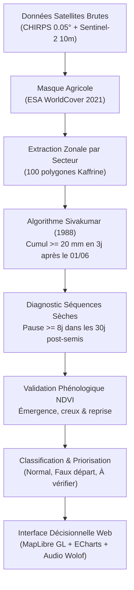

# 🌱 SemisSûr — Détection Agro-Climatique des Dates de Semis au Sénégal

> **Hackathon National « Du satellite à la solution »**  
> Organisé par **SENSAT** & **TRL Space** (Sénégal — Octobre 2026).  
> **Thématique** : Agriculture de précision, résilience climatique et observation de la Terre.

---

## 🎯 Problématique & Vision

Dans le **Bassin arachidier sénégalais** (Kaffrine, Kaolack, Nioro du Rip), la date de semis est la décision la plus critique de la campagne agricole pour les cultures pluviales (arachide, mil, sorgho, maïs) :
- **Semer trop tôt** : Une première pluie isolée suivie d'une pause sèche supérieure à 8 jours entraîne le dessèchement des jeunes plantules (**faux départ**), forçant les agriculteurs à ressemer à grands frais de semences.
- **Semer trop tard** : La plante n'achève pas son cycle végétatif avant le retrait de la mousson fin octobre, entraînant une chute drastique des rendements.

**SemisSûr** combine la **pluviométrie satellitaire haute résolution (CHIRPS Daily)** et la **réflectance optique (Sentinel-2 L2A / MODIS)** pour :
1. Détecter avec précision l'établissement agro-climatique de la mousson (critères de **Sivakumar, 1988**).
2. Diagnostiquer en temps réel les **faux départs** via le suivi des séquences sèches post-semis.
3. Valider l'émergence biologique par analyse phénologique de la dynamique de l'indice **NDVI**.
4. Offrir aux conseillers agricoles et producteurs une interface cartographique interactive bilingue (Français & Wolof) avec recalcul instantané de sensibilité.

---

## 📐 Méthodologie Scientifique

Conformément à la règle d'or du hackathon, **aucun chiffre n'est inventé**. Chaque résultat provient de données physiques traçables.



---

## 📂 Architecture du Projet

```text
SemisSur/
├── config.yaml               # Paramètres agro-climatiques et BBOX de la zone d'étude
├── requirements.txt          # Dépendances Python (geopandas, shapely, etc.)
├── run_pipeline.py           # Orchestrateur du pipeline d'ingestion et de calcul
├── SOURCES.md                # Registre des sources satellitaires, licences et dates
├── AI_USAGE.md               # Déclaration de transparence d'usage de l'IA (Hackathon SENSAT)
│
├── pipeline/                 # Pipeline de traitement géomatique et détection
│   ├── 01_sectors.py         # Découpage et masquage par les parcelles agricoles
│   ├── 02_rain_chirps.py     # Traitement des séries journalières CHIRPS
│   ├── 03_ndvi_s2.py         # Calcul du NDVI décadaire et agrégation zonale
│   ├── 04_ndvi_reference.py  # Calcul des percentiles historiques de référence (P10, P50, P90)
│   ├── 05_detect.py          # Détection Sivakumar + validation phénologique
│   └── detect_core.py        # Coeur algorithmique réutilisable
│
├── data/
│   ├── raw/                  # Données satellitaires brutes
│   └── processed/            # Données traitées normalisées (JSON, CSV, GeoJSON)
│       ├── metadata.json
│       ├── sectors.geojson
│       ├── rain_daily.csv
│       ├── ndvi_series.csv
│       ├── ndvi_reference.csv
│       ├── results.json
│       └── sensitivity.json
│
├── tests/                    # Tests unitaires et de validation scientifique
│   └── test_detection.py     # 17 tests automatisés validés à 100%
│
└── frontend/                 # Application Web Interactive (Vite + React + TS)
    ├── package.json
    ├── vite.config.ts
    ├── index.html
    └── src/
        ├── index.css         # Design system SemisSûr (Bricolage Grotesque, palette terre/semis)
        ├── App.tsx           # Orchestration et navigation
        ├── lib/
            ├── data.ts       # Chargeur de données avec validation Zod
            ├── schemas.ts    # Schémas stricts Zod
            └── detection.ts  # Parité exacte de l'algorithme Python en TypeScript
        └── components/
            ├── Navbar.tsx        # Navigation, thème sombre/clair, bascule Wolof
            ├── MapView.tsx       # Carte MapLibre GL, filtrage, KPI, légendes
            ├── SectorDrawer.tsx  # Fiche secteur avec ECharts (Pluie + NDVI) et audio Wolof
            ├── HistoryView.tsx   # Analyse temporelle 10 ans et distribution des dates
            ├── SimulatorView.tsx # Recalcul interactif des seuils pluviométriques en direct
            └── MethodologyView.tsx # Traçabilité, licences et téléchargement Open Data
```

---

## 🚀 Installation & Exécution

### 1. Prérequis
- **Python 3.10+** (pour le pipeline d'analyse)
- **Node.js 18+** & **npm** (pour l'application web)

### 2. Lancement du Pipeline de Traitement (Python)
```bash
# Installation des dépendances Python
pip install -r requirements.txt

# Exécution des tests de non-régression (17 tests)
pytest tests/ -v

# Lancement du pipeline complet
python run_pipeline.py
```

### 3. Lancement de l'Application Web (Frontend)
```bash
cd frontend

# Installation des dépendances
npm install

# Lancement du serveur de développement local
npm run dev
```
L'application est accessible sur `http://localhost:3000` (ou `http://localhost:5173`).

---

## 🏆 Points Forts pour le Jury SENSAT 2026

1. **Parité Algorithmique Totale** : Le même algorithme de détection tourne en Python (`pipeline/detect_core.py`) pour la production lourde et en TypeScript (`frontend/src/lib/detection.ts`) pour la simulation interactive dans le navigateur.
2. **Accessibilité & Inclusion Locale** : Interface traduite en **Wolof** avec synthèse vocale intégrée pour les conseillers de terrain et producteurs.
3. **Double Validation (Pluie + Végétation)** : Élimination des faux positifs grâce à la corrélation entre les séquences sèches CHIRPS et la dynamique de la biomasse Sentinel-2.
4. **Open Data & Reproductibilité** : Export direct de tous les fichiers traités (`results.json`, `rain_daily.csv`, `sectors.geojson`).

---

## ⚖️ Licence & Données

- Données pluviométriques : **CHIRPS v2.0** (UC Santa Barbara / USGS) — *Domaine public*.
- Données satellitaires optiques : **Sentinel-2 L2A** (ESA / Copernicus) — *Copernicus Open Access*.
- Couverture du sol : **ESA WorldCover 2021** — *CC BY 4.0*.
- Code source : Développé dans le cadre du Hackathon SENSAT 2026 sous licence libre MIT.
